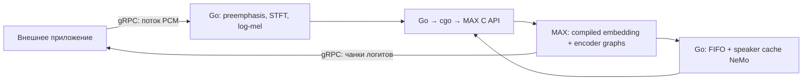

# Nemotron 3 Diarization · Go + MAX CPU

gRPC-сервис для `nvidia/Nemotron-3-Diarization`. Принимает **декодированный mono
PCM 16 kHz, float32 little endian** и возвращает логиты активности спикеров
с шагом 10 ms. WAV/MP3, ресэмплинг и ASR в сервис не входят.



Сервер и preprocessing написаны на Go. Небольшой C bridge управляет объектами
MAX и временем жизни буферов. Нейросеть исполняется MAX 26.7.0 на CPU в float32.
Python используется **один раз для экспорта** MEF-графов и отдельно в тестах.
В процессе сервера нет Python, HTTP-обёртки или вызовов NeMo/PyTorch.

## Подготовка и запуск

Linux x86-64, Go ≥ 1.24, C compiler, Python 3.12 для подготовки MAX SDK/графов.
Checkpoint должен содержать `config.json`, `processor_config.json` и
`model.safetensors` либо shards с индексом. Веса распространяются отдельно.

```bash
uv venv
uv pip install --python .venv/bin/python -e .

# Эти пути нужны, только если стандартный ~/.cache недоступен для записи.
export XDG_CACHE_HOME="$PWD/.cache"
export UV_CACHE_DIR="$PWD/.cache/uv"

.venv/bin/python -m nemotron_diarization_max.export \
  --model models/nemotron --output models/nemotron-cpu

make build
export MAX_ROOT="$(.venv/bin/python -c 'import site; print(site.getsitepackages()[0])')/modular"
bin/nemotron-server --model models/nemotron-cpu --listen 0.0.0.0:50051
```

Сервер загружает готовые `*.mef`, `weights.safetensors`, `constants.f32` и
`manifest.json`. Необходимы библиотеки MAX SDK; одного Go-бинарника недостаточно.
MEF зависит от версии MAX и целевой платформы: экспортируйте для используемого
CPU с той же версией SDK. При переносе SDK в другой каталог задайте `MAX_ROOT`
и `LD_LIBRARY_PATH="$MAX_ROOT/lib"`. Python запускать на сервере не требуется.

`make` принимает `GO`, `PYTHON`, `MAX_SITE`, `MAX_ROOT`, если инструменты/SDK
установлены нестандартно. По умолчанию SDK берётся из `.venv`.

## API

Контракт и сгенерированные Go-клиенты: [api/diarization/v1](api/diarization/v1/diarization.proto).
Один bidirectional RPC `diarization.v1.Diarization/Diarize` — одна запись:

1. Отправляйте `AudioChunk.pcm_f32le`: байты PCM без заголовка файла.
   Каждое сообщение содержит целое число float32-сэмплов. Границы транспортных
   чанков произвольные; рекомендуемый размер — 64 KiB. Лимит сообщения — 1 MiB.
2. Одновременно читайте `Prediction`. Поля `start_frame`, `num_frames`,
   `num_speakers` описывают `logits_f32le`: row-major `[frames, speakers]`.
   `start_frame` — абсолютный индекс кадра от начала записи, время = индекс × 0.01 s.
3. После последнего сэмпла вызовите `CloseSend()` и дочитайте ответы до EOF:
   сервер дополнит последнее окно и вернёт остаток.

Читайте ответы параллельно с отправкой: в обе стороны действует gRPC flow control.
Пример полноценного клиента — [cmd/diarize/main.go](cmd/diarize/main.go):

```bash
bin/diarize --input recording.f32 --output logits.f32
```

Ответ содержит **сырые логиты**, для модели NVIDIA — восемь спикеров.
`logit > 0` соответствует вероятности `> 0.5`. Несколько спикеров могут быть
активны одновременно. Для аудио длиной N сэмплов возвращается `floor(N/160)`
кадров; последний служебный кадр frontend и дополнение feature stacking удаляются.
Минимальный вход — 160 сэмплов. Неполные float32 и NaN/Inf отклоняются.

## Длинные записи

Используется offline-профиль checkpoint: **340 новых encoder-кадров = 27.2 s**,
правый контекст **40 кадров = 3.2 s**, FIFO 40, speaker cache 264, период
обновления 300. Все величины читаются из экспортированного manifest.
Транспортный чанк не определяет размер шага модели.

Из NeMo перенесены `streaming_update` и политика `_compress_spkcache`: перенос
кадров из FIFO, обновление оценок, log scores, strong/weak/latest boosting,
silence slots и порядок кадров внутри спикера. Исходная ревизия указана в
[NOTICE](NOTICE). Это синхронный алгоритм NeMo для обработки длинной записи;
каждый RPC обрабатывает один файл. Frontend и соответствие имён весов взяты
из реализации именно Nemotron-3-Diarization в Transformers.

Preemphasis, перекрытие STFT, embeddings контекста и speaker cache сохраняются
между транспортными чанками. Весь двухчасовой PCM, mel-матрица и все результаты
не накапливаются: сервер обрабатывает и отдаёт их порциями. На двухчасовую запись
получается около 265 шагов модели. Размер состояния Go ограничен размерами окон.

Состояние существует только внутри RPC и удаляется после завершения/отмены.
Нет реестра сессий, TTL, кэша результатов и дополнительных endpoints. Speaker ID
согласованы внутри записи; разные RPC независимы. Для одной записи нужен один RPC.
Одна общая модель выполняет CPU-вызовы последовательно; ожидание происходит
в Go, без отдельного заблокированного системного потока на запрос. MAX использует
собственные рабочие потоки. Автоматический batching и MAX Serve не используются.
Лимит — восемь параллельных RPC на соединение. При отмене записи текущий
синхронный вызов MAX завершается, после чего обработка прекращается.

## Проверки

```bash
make test

# Численная проверка всей цепочки Go/gRPC → MAX C API:
uv pip install --python .venv/bin/python torch --index-url https://download.pytorch.org/whl/cpu
uv pip install --python .venv/bin/python -e '.[test,reference]'
curl -fL https://raw.githubusercontent.com/NVIDIA-NeMo/Speech/8eb458b8ee304143426be5070d3f55fb3b5fb736/nemo/collections/asr/modules/sortformer_modules.py \
  -o /tmp/sortformer_modules.py
.venv/bin/python scripts/prepare_go_fixtures.py \
  --output /tmp/nemotron-go-fixture --nemo-source /tmp/sortformer_modules.py
NEMOTRON_TEST_BUNDLE=/tmp/nemotron-go-fixture make test
.venv/bin/pytest -q
```

Тесты без `NEMOTRON_TEST_BUNDLE` проверяют границы чанков, завершение потока,
отмену, ошибки отправки и ограниченность состояния на эквиваленте двух часов.
С fixture проверяются frontend, native MAX/gRPC и upstream Transformers, а также
обновления и сжатие cache непосредственно оригинальными методами NeMo.
Результаты: [docs/validation-go-cpu.json](docs/validation-go-cpu.json).
Fixture использует маленькую модель со случайными весами: это проверка реализации,
а не качества диаризации. Настоящие веса и скорость полного приложения на речи
пока не проверены. Историческая проверка полной 31-слойной конфигурации MAX
со случайными весами: [docs/validation-cpu-synthetic.json](docs/validation-cpu-synthetic.json).

Подробности вычислений: [docs/architecture.md](docs/architecture.md).
