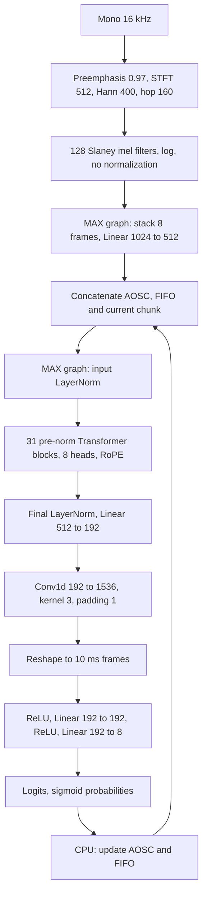

# Архитектура и границы переноса

Источники изучены 29 октября 2026:

- [Конфигурация и карточка NVIDIA](https://huggingface.co/nvidia/Nemotron-3-Diarization).
- [NeMo SortformerEncLabelModel](https://github.com/NVIDIA-NeMo/Speech/blob/8eb458b8ee304143426be5070d3f55fb3b5fb736/nemo/collections/asr/models/sortformer_diar_models.py).
- [NeMo SortformerModules, streaming_update и compress_spkcache](https://github.com/NVIDIA-NeMo/Speech/blob/8eb458b8ee304143426be5070d3f55fb3b5fb736/nemo/collections/asr/modules/sortformer_modules.py).
- [Transformers, прямое соответствие safetensors](https://github.com/huggingface/transformers/blob/420dca92a4cf7d96dfbc1cc46f00375b0681ff8f/src/transformers/models/nemotron3_diarization/modeling_nemotron3_diarization.py).
- [Frontend](https://github.com/huggingface/transformers/blob/420dca92a4cf7d96dfbc1cc46f00375b0681ff8f/src/transformers/models/nemotron_asr_streaming/feature_extraction_nemotron_asr_streaming.py).

## Вычисления

Feature stacking pads the final incomplete group with zero mel vectors.
Encoder attention is bidirectional within the complete step input, including
cache and look-ahead. This is not causal LLM attention. There is no autoregressive
KV cache. Positions restart from zero at each encoder invocation.

LayerNorm epsilon is 1e-5; GELU is exact (`approximate="none"`). Q/K/V have no
bias, attention output and feed-forward projections have biases. RoPE rotates
two contiguous halves of each head, not interleaved even/odd coordinates.
The Conv1d cross-correlation is expressed as a single matmul over concatenated
left/current/right taps. The subpixel reshape preserves the original channel
ordering; repeating encoder frames would be incorrect.

All learned projections, attention, activation functions and upsampling execute
inside MAX. Go handles preprocessing and state policy in the service; NumPy is
used only in the Python reference/export tools. No PyTorch export,
ONNX, NeMo inference, or silent backend fallback is used. The CPU implementation
uses standard MAX ops; no additional Mojo kernel is required at this stage.

## Cache policy

1. Encoder input is `[speaker cache | FIFO | look-back | chunk | look-ahead]`.
2. Sigmoid probabilities are averaged over each group of eight output frames.
3. Only new chunk frames enter the FIFO. Look-back/look-ahead do not enter it.
4. On FIFO overflow, move at least the update-period count, or more if required
   to restore capacity, to the speaker cache.
5. Before the first compression, refresh cache scores from current predictions.
   After compression, preserve stored probabilities, since cached frames are
   grouped by speaker rather than chronologically contiguous.
6. Compress using log scores that favor non-overlapping speech, per-speaker
   strong/weak boosting, a bonus for recent frames and reserved silence slots.
7. Sort selected speaker-major indices to retain arrival ordering within each
   speaker's frames. Disabled slots use the learned `silence_embeds` and zero
   probabilities.

Go and the NumPy reference use deterministic stable selection on equal scores. Upstream `torch.topk`
does not guarantee tie order. On exactly tied finite scores, the selected cache
frames can differ; tests cover distinct finite scores and disabled/silence slots.
Small float32 differences can also alter discrete choices at exact thresholds.

The Go service uses offline defaults: chunk 340, right context 40, FIFO 40,
update period 300, cache 264. The checkpoint also describes streaming defaults
with FIFO 264 and update period 222. Its low-latency profile uses
chunk 9 and right context 4. All these counts refer to 80 ms encoder frames.

## CPU deployment choices

Both MAX graphs accept dynamic batch/time dimensions. Cache growth does not
require rebuilding a graph. All weights are validated against names and shapes
before graph compilation. Weights are external graph weights, not embedded
compile-time constants. The shard index may name only local filenames; standard
Hugging Face cache symlinks to blob storage are supported. Inference output
buffers are copied before returning to callers.

The Go service exposes a single bidirectional gRPC method. Each RPC accepts PCM
chunks for one recording and returns raw float32 logits with absolute frame
offsets. There is no file decoding or resampling. Python builds CPU MEF artifacts
once; the Go process loads them through MAX's public C API, with external
safetensors weights. No Python interpreter or interprocess inference hop is used.

The frontend preserves preemphasis and STFT overlap across arbitrary transport
boundaries. It uses a Gonum real FFT and only nonzero regions of the exported
Slaney filters. Windowing, power and mel accumulation retain float32 rounding;
FFT work and log use float64, with results rounded back to float32. Numerical
tests compare this frontend with upstream. Hann, mel and inverse RoPE frequencies
are exported as exact float32 constants. RoPE sine/cosine tables are built once
for the maximum encoder step, not for the recording length.

Only embeddings for the next chunk, right/left context and bounded AOSC/FIFO
state are retained. Final STFT padding, feature-stacking padding and key masks
match the checkpoint frontend; extra output frames are trimmed. Outputs are
sent incrementally and gRPC flow control provides backpressure.

RPCs are independent: no session registry, TTL or result cache. AOSC/FIFO are
private to one RPC and discarded when it completes. Updating this state after
the last offline chunk is skipped. Speaker IDs are local to the recording.

One CPU graph call runs at a time, gated by a cancellable Go channel. MAX uses
its own CPU execution threads. C borrows Go numeric buffers only during a single
synchronous cgo call and copies completed outputs into Go-owned buffers before
returning. All tensor handles are released; safetensors and the weights registry
outlive both models. The service does not use MAX Serve or a batching scheduler.

GPU device placement, BF16, fused attention kernels, device-resident cache updates,
and benchmarking against NeMo are later optimization work. CPU numerical
correctness must be established before making performance claims.
