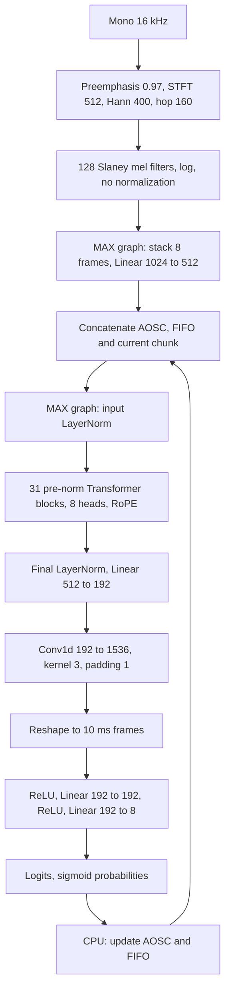

# Архитектура и границы переноса

Источники изучены 29 октября 2026:

- [Конфигурация и карточка NVIDIA](https://huggingface.co/nvidia/Nemotron-3-Diarization).
- [NeMo SortformerEncLabelModel](https://github.com/NVIDIA-NeMo/Speech/blob/8eb458b8ee304143426be5070d3f55fb3b5fb736/nemo/collections/asr/models/sortformer_diar_models.py).
- [NeMo SortformerModules, streaming_update и compress_spkcache](https://github.com/NVIDIA-NeMo/Speech/blob/8eb458b8ee304143426be5070d3f55fb3b5fb736/nemo/collections/asr/modules/sortformer_modules.py).
- [Transformers, прямое соответствие safetensors](https://github.com/huggingface/transformers/blob/420dca92a4cf7d96dfbc1cc46f00375b0681ff8f/src/transformers/models/nemotron3_diarization/modeling_nemotron3_diarization.py).
- [Frontend](https://github.com/huggingface/transformers/blob/420dca92a4cf7d96dfbc1cc46f00375b0681ff8f/src/transformers/models/nemotron_asr_streaming/feature_extraction_nemotron_asr_streaming.py).

## Вычисления

Feature stacking pads the final incomplete group with zero mel vectors.
Encoder attention is bidirectional within the complete step input, including
cache and look-ahead. This is not causal LLM attention. There is no autoregressive
KV cache. Positions restart from zero at each encoder invocation.

LayerNorm epsilon is 1e-5; GELU is exact (`approximate="none"`). Q/K/V have no
bias, attention output and feed-forward projections have biases. RoPE rotates
two contiguous halves of each head, not interleaved even/odd coordinates.
The Conv1d cross-correlation is expressed as a single matmul over concatenated
left/current/right taps. The subpixel reshape preserves the original channel
ordering; repeating encoder frames would be incorrect.

All learned projections, attention, activation functions and upsampling execute
inside MAX. NumPy handles pre/postprocessing and state policy. No PyTorch export,
ONNX, NeMo inference, or silent backend fallback is used. The CPU implementation
uses standard MAX ops; no additional Mojo kernel is required at this stage.

## Cache policy

1. Encoder input is `[speaker cache | FIFO | look-back | chunk | look-ahead]`.
2. Sigmoid probabilities are averaged over each group of eight output frames.
3. Only new chunk frames enter the FIFO. Look-back/look-ahead do not enter it.
4. On FIFO overflow, move at least the update-period count, or more if required
   to restore capacity, to the speaker cache.
5. Before the first compression, refresh cache scores from current predictions.
   After compression, preserve stored probabilities, since cached frames are
   grouped by speaker rather than chronologically contiguous.
6. Compress using log scores that favor non-overlapping speech, per-speaker
   strong/weak boosting, a bonus for recent frames and reserved silence slots.
7. Sort selected speaker-major indices to retain arrival ordering within each
   speaker's frames. Disabled slots use the learned `silence_embeds` and zero
   probabilities.

NumPy uses deterministic stable selection on equal scores. Upstream `torch.topk`
does not guarantee tie order. On exactly tied finite scores, the selected cache
frames can differ; tests cover distinct finite scores and disabled/silence slots.
Small float32 differences can also alter discrete choices at exact thresholds.

Offline defaults: chunk 340, right context 40, FIFO 40, update period 300.
Streaming: cache 264, FIFO 264, update period 222. The low-latency profile uses
chunk 9 and right context 4. All these counts refer to 80 ms encoder frames.

## CPU deployment choices

Both MAX graphs accept dynamic batch/time dimensions. Cache growth does not
require rebuilding a graph. All weights are validated against names and shapes
before graph compilation. Weights are external graph weights, not embedded
compile-time constants. The shard index may name only local filenames; standard
Hugging Face cache symlinks to blob storage are supported. Inference output
buffers are copied before returning to callers.

The HTTP service exposes only `/infer/audio` and `/infer/features`. Requests and
responses are raw little-endian float32 bytes. Audio is mono at 16 kHz; features
are row-major log-mel matrices. Responses contain raw logits, not probabilities
or segments. Input arrays are views of the request bytes, without JSON numeric
lists, file decoding, or resampling. The model is compiled once at startup.

Requests are independent: no session registry, TTL, result cache, or state shared
between requests. AOSC/FIFO are private to a single model call and discarded when
it completes. Updating this state after the last offline chunk is skipped.
Speaker IDs have no correspondence across separate requests.

One CPU inference runs at a time through an asynchronous capacity limiter, so
requests wait without holding a blocked request thread. MAX uses its own CPU
execution threads. This is not a batching scheduler. The service does not use
MAX Serve, and concurrent execution on one model instance is not enabled.

GPU device placement, BF16, fused attention kernels, device-resident cache updates,
and benchmarking against NeMo are later optimization work. CPU numerical
correctness must be established before making performance claims.
